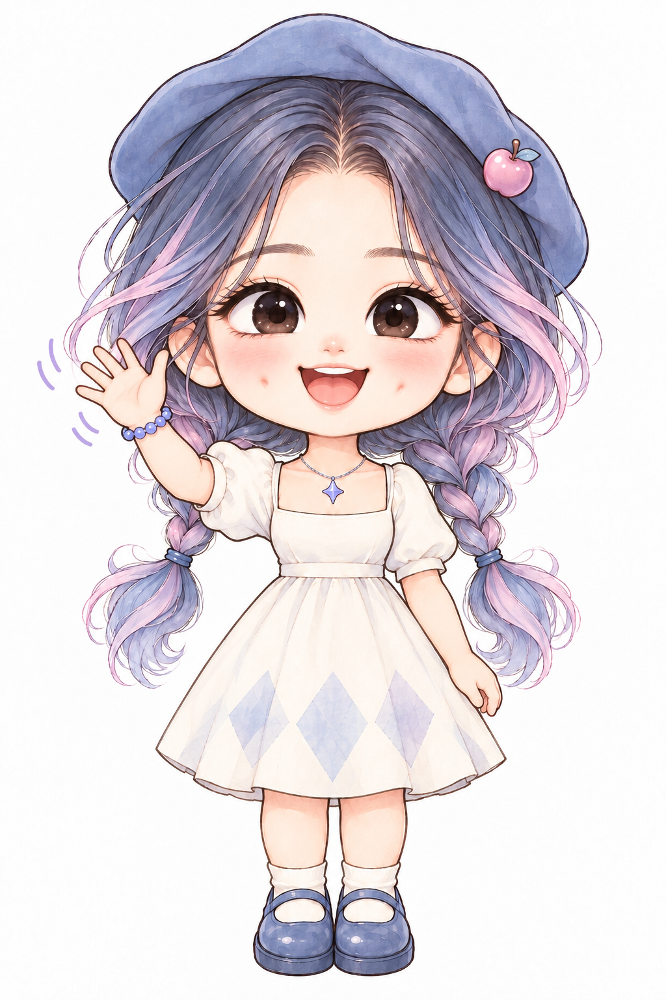
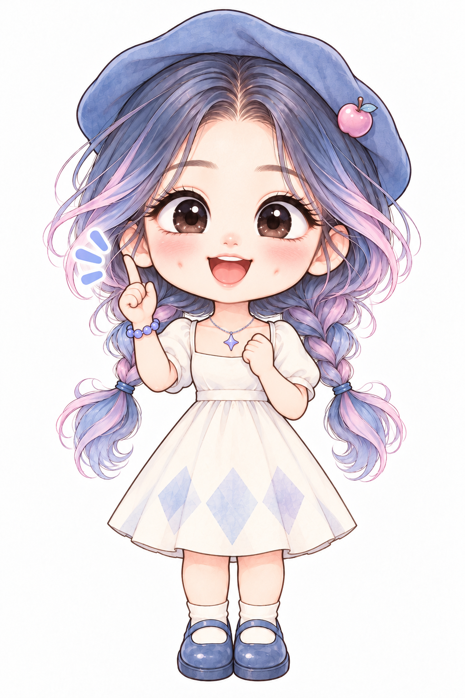
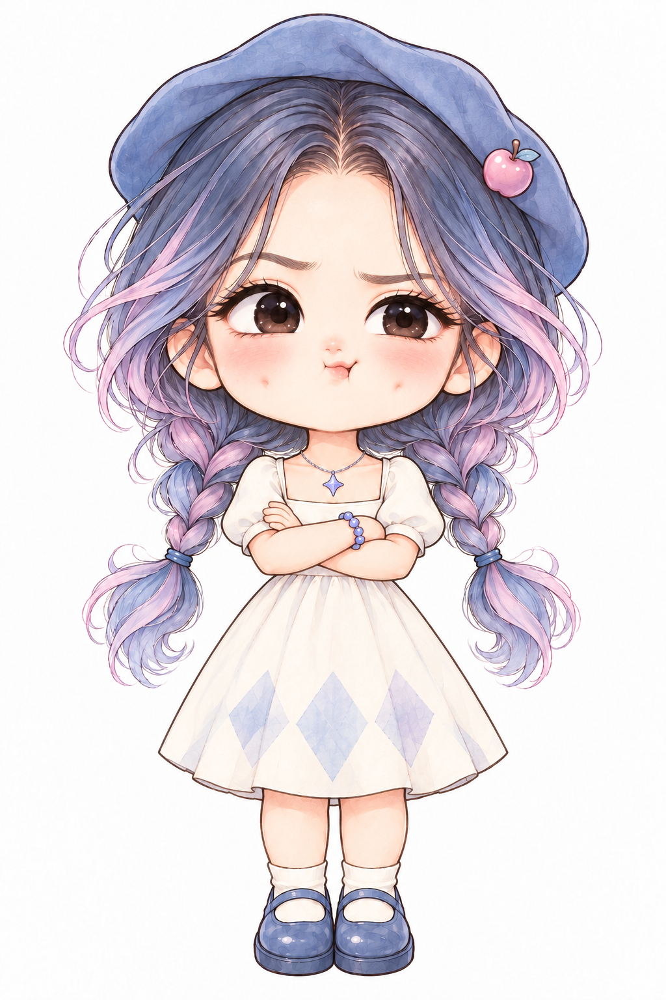

# Lexie 正文配图 Skill

> A watercolor chibi illustration skill for Chinese articles, posts, blogs, Notion pages, workflows, and explainers.

`lexie-skill` 会把中文正文中的关键判断、流程、结构、状态和隐喻，转成 **16:9 白底手绘正文配图**。默认主角是 Lexie：粉蓝＋粉紫双辫、蓝色贝雷帽、奶油色连衣裙，整体可爱、傲娇，也保留一点怪诞感。

> [!IMPORTANT]
> Skill 指令与文档采用 MIT License；Lexie 角色图片采用 CC BY-NC 4.0，**不属于 MIT 授权范围，不可商用**。详情见[授权说明](#授权说明)。


## 适用场景

- 中文文章、博客和公众号正文配图
- 小红书长文、知识卡片和观点解释
- Notion 文档、工作流和方法论
- 流程、分流、闭环、前后对比与状态变化
- 需要个人 IP 主角参与表达的视觉隐喻

## 它能做什么

- 先分析正文，找出真正值得画的关键段落
- 输出简洁的配图策略或 shot list
- 为每张图选择合适的结构、隐喻与 Lexie 动作
- 保持 16:9、纯白背景、黑色手绘结构线和大量留白
- 使用少量中文手写批注，避免 PPT 感和商业模板感
- 通过固定角色参考与检查清单降低角色漂移

## 角色动作参考

| 开心招手 | 灵感来了 | 不太认同 |
| --- | --- | --- |
|  |  |  |

仓库还包含叉腰得意、思考和无奈摊手等动作。生成时以 `00-master.png` 为身份主参考，再选择一张最接近当前动作的参考图，不需要一次加载全部素材。

## 安装

Skill 的入口文件是根目录下的 `SKILL.md`。请把整个仓库放进 Codex 的 skills 目录，确保最终结构为：

```text
~/.codex/skills/lexie-skill/SKILL.md
```

### macOS / Linux

```bash
git clone https://github.com/haluwjm-byte/lexie-skill.git ~/.codex/skills/lexie-skill
```

### Windows PowerShell

```powershell
git clone https://github.com/haluwjm-byte/lexie-skill.git "$env:USERPROFILE\.codex\skills\lexie-skill"
```

也可以从 [Releases](https://github.com/haluwjm-byte/lexie-skill/releases) 下载 ZIP，解压后把完整文件夹放到上述目录。

## 使用示例

在 Codex 中明确调用：

```text
请使用 $lexie-skill，先分析这篇文章需要哪些正文配图，再生成 4 张 16:9 白底手绘插图。
```

只需要策略时：

```text
请使用 $lexie-skill，为下面这篇文章设计配图 shot list，先不要生成图片。
```

没有明确指定其他角色时，skill 会默认使用 Lexie。若用户指定了其他角色，则以用户指令为准，不混入 Lexie。

## 目录结构

```text
lexie-skill/
├─ SKILL.md
├─ agents/
│  └─ openai.yaml
├─ references/
│  ├─ lexie-ip.md
│  ├─ style-dna.md
│  ├─ composition-patterns.md
│  ├─ prompt-template.md
│  └─ qa-checklist.md
└─ assets/
   └─ lexie-character/
      ├─ 00-master.png
      └─ 01–06 动作参考图
```

## 设计原则

1. Lexie 必须亲自完成画面的核心动作，不能只站在旁边装饰。
2. 每张图只讲一个核心结构，复杂信息优先拆图。
3. 画面要有奇怪但成立的原创隐喻，不复刻旧案例。
4. 角色可以可爱，整张图不能变成萌系海报、儿童插画或商业卡通。
5. 角色身份、配色、服装、比例和腿部简化方式必须保持稳定。

## 授权说明

本仓库采用双授权：

- `SKILL.md`、`agents/`、`references/`、本 README 与其他配置文件：**MIT License**，见 [`LICENSE`](LICENSE)。
- `assets/lexie-character/` 下的全部 Lexie 角色图片：**CC BY-NC 4.0**，必须署名 **Lexie / @haluwjm-byte**、注明是否修改，并且不得用于商业目的，见 [`ASSET_LICENSE.md`](ASSET_LICENSE.md)。

Lexie 角色图片不属于 MIT 授权范围。姓名、肖像、人格和品牌标识等可能涉及的其他权利并未因仓库公开而自动授予。

## 反馈与贡献

欢迎通过 GitHub Issues 反馈角色一致性、安装、触发和配图效果问题。提交建议时请附上使用场景和期望结果，不要上传包含隐私或未获授权的人像素材。

---

Created by **Lexie / [@haluwjm-byte](https://github.com/haluwjm-byte)**.
